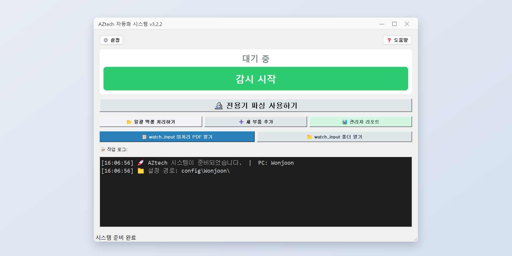
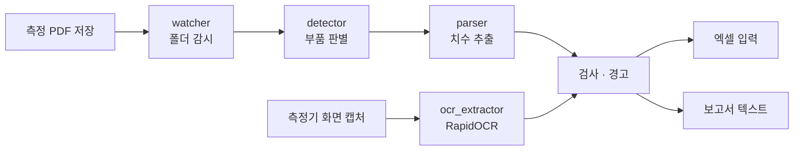

# 측정 데이터 자동화 시스템 (PDF · OCR)

> 생산 현장의 3차원 측정기(CMM) 결과를 읽어, 엑셀 입력과 보고까지 자동으로 처리하는 Windows 데스크톱 프로그램.



## 왜 만들었나

산업기능요원으로 근무하는 제조 현장에서는 측정기가 만든 결과 PDF의 수백 개 항목 중
필요한 치수만 사람이 찾아 엑셀에 옮겨 적고, 다시 메신저로 보고하고 있었다.
반복 작업이라 시간이 오래 걸리고 옮겨 적는 과정에서 실수가 생겨서,
이 과정을 처음부터 끝까지 자동화하는 프로그램을 만들어 현장에 배포했다.

## 주요 기능

| 기능 | 내용 |
| --- | --- |
| **실시간 폴더 감시** | 지정한 폴더에 측정 PDF가 생기면 바로 감지해 작업 창을 띄운다. |
| **핵심 치수 추출** | 부품별 규칙(레지스트리 JSON + 정규표현식)으로 수백 개 항목 중 필요한 값만 골라낸다. |
| **불량 경고** | NG · 상한/하한 공차 인접 항목을 로그 창에 표시해 육안 검사를 돕는다. |
| **특수 검사 규칙** | 두 측정값의 편차처럼 표 하나로는 안 보이는 조건을 규칙 파일로 정의해 경고한다. |
| **엑셀 자동 입력 · 보고서** | 클릭 한 번으로 지정 셀에 기입하고, 보고 양식에 맞춘 텍스트를 클립보드에 복사한다. |
| **측정기 화면 OCR** | 측정 프로그램 화면을 캡처해 붙여넣으면 수치를 인식해 입력한다 (RapidOCR). |
| **일괄 처리** | 놓친 PDF나 과거 파일을 한 번에 처리한다. |
| **부품 추가 마법사** | 새 부품의 추출 규칙을 화면에서 만들어 레지스트리에 추가한다. |

## 구조



```
├── core/        # 분석 엔진 — 폴더 감시, 부품 판별, PDF 파싱, OCR
├── ui/          # PyQt5 화면 — 메인, 입력, 설정, 일괄 처리, OCR 창, 부품 마법사
├── modules/     # 엑셀 입력, 보고서, 파일 관리, 특수 검사
├── config/      # 경로 · OCR 포맷 · 검사 규칙 설정
├── assets/data/ # 아이콘, 부품 레지스트리(예시)
└── main.py
```

## 기술 스택

- **Python** 3.8 (구형 Windows 7 현장 PC 지원을 위해 3.8 기반으로 빌드)
- **UI** PyQt5
- **PDF** PyPDF2 · 정규표현식
- **OCR** RapidOCR (onnxruntime) — Windows 7 에서도 돌도록 onnxruntime 버전을 맞춤
- **엑셀** openpyxl · **감시** watchdog
- **배포** PyInstaller 단일 exe, GitHub Actions 로 태그를 올리면 자동 빌드

## 공개 저장소에 대해

이 프로그램은 실제 제조 현장에서 쓰고 있으며, 공개 저장소에는 **코드만** 올렸다.

- 실제 부품 목록 · 치수 규칙 · 검사 기준값은 회사 정보라서 넣지 않았다.
- 대신 구조만 같은 예시 파일을 넣었다.
  - `assets/data/parts_registry.example.json` — 부품 판별 · 추출 규칙 예시
  - `config/special_checks.example.json` — 특수 검사 규칙 예시
- 실제 파일(`parts_registry_v2.json`, `special_checks.json`)이 있으면 그것을, 없으면 예시 파일을 읽는다.

## 실행

```powershell
python -m venv venv38          # Python 3.8
.\venv38\Scripts\Activate.ps1
pip install -r requirements.txt
python main.py
```

### exe 빌드

```powershell
pip install -r requirements-build.txt
pyinstaller AZtech.spec --noconfirm
```

`v*` 태그를 올리면 GitHub Actions 가 같은 방식으로 빌드해 릴리스에 올린다.

## 만든 방법

현장 문제 파악, 기능 기획, 검증, 현장 배포와 유지보수는 직접 했고,
코드 작성에는 Claude Code 를 적극적으로 활용했다.
