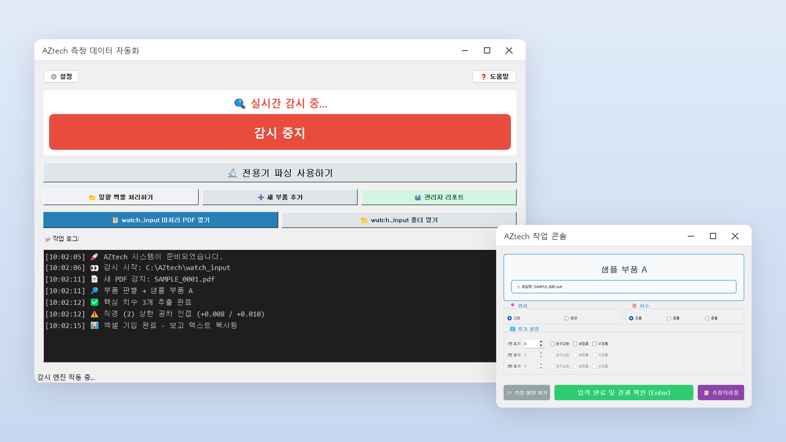
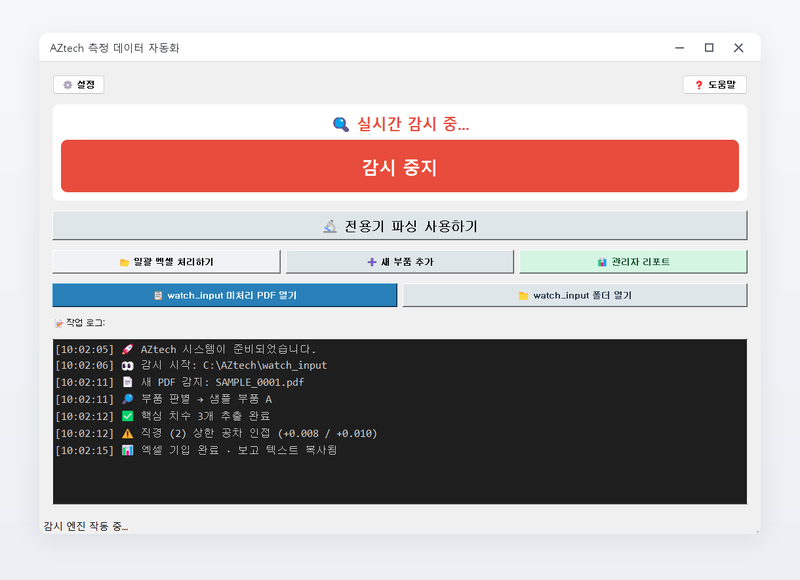
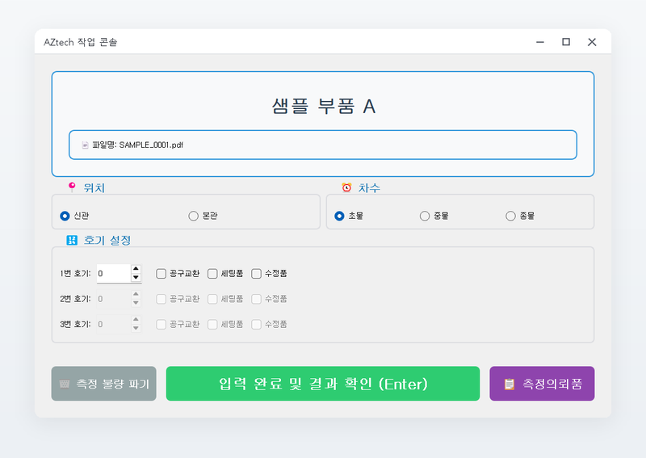
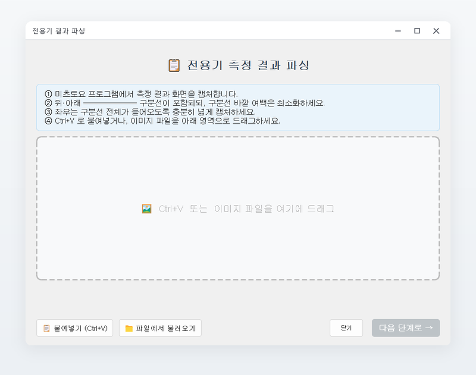
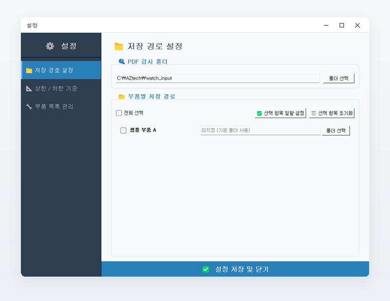
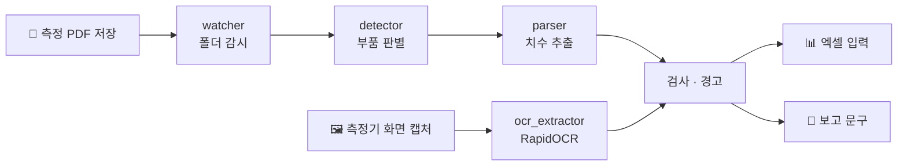

<div align="center">

# 📐 측정 데이터 자동화 (PDF · OCR)

**3차원 측정기(CMM) 결과 PDF가 저장되는 순간, 파일 정리 · 치수 추출 · 엑셀 입력 · 보고 문구까지 자동으로 처리하는 Windows 데스크톱 프로그램**

<br />


<br />



<sub>스크린샷의 부품 · 파일 · 측정값은 모두 예시 데이터입니다.</sub>

</div>

<br />

## ✨ 주요 기능

| | 기능 | 내용 |
| :-: | --- | --- |
| 👀 | **실시간 폴더 감시** | 지정한 폴더에 측정 PDF가 생기면 바로 감지해 작업 창을 띄운다. |
| 🗂️ | **저장 위치 · 파일명 자동 정리** | 부품별로 정해진 폴더에 정해진 이름으로 PDF를 옮기고, 직전 작업 위치와 호기를 기억해 반복 입력을 줄인다. |
| 🔎 | **핵심 치수 추출** | 부품별 규칙(레지스트리 JSON + 정규표현식)으로 수백 개 항목 중 필요한 값만 골라낸다. |
| ⚠️ | **불량 · 공차 경고** | NG 항목과 상한 · 하한 공차에 가까운 항목을 로그 창에 표시한다. |
| 🧩 | **특수 검사 규칙** | 두 측정값의 편차처럼 표 하나로는 안 보이는 조건을 규칙 파일로 정의해 경고한다. |
| 📊 | **엑셀 입력 · 보고 문구** | 클릭 한 번으로 지정 셀에 기입하고, 보고 양식에 맞춘 텍스트를 클립보드에 복사한다. |
| 🔬 | **전용기 OCR** | PDF가 나오지 않는 전용 측정기는 결과 화면을 캡처해 붙여 넣으면 수치를 인식한다. |
| 📦 | **일괄 처리** | 놓친 PDF나 과거 파일을 한 번에 처리한다. |
| ➕ | **부품 추가 마법사** | 새 부품의 추출 규칙을 화면에서 만들어 레지스트리에 추가한다. |

<br />

## 📸 화면

<table>
  <tr>
    <td align="center" width="50%"></td>
    <td align="center" width="50%"></td>
  </tr>
  <tr>
    <td align="center"><b>메인 화면</b><br /><sub>폴더 감시 · 작업 로그 · 일괄 처리 · 부품 추가</sub></td>
    <td align="center"><b>작업 콘솔</b><br /><sub>PDF가 들어오면 뜨는 창 — 위치 · 차수 · 호기 입력</sub></td>
  </tr>
  <tr>
    <td align="center"></td>
    <td align="center"></td>
  </tr>
  <tr>
    <td align="center"><b>전용기 OCR</b><br /><sub>측정 화면 캡처를 붙여 넣으면 수치 인식</sub></td>
    <td align="center"><b>설정</b><br /><sub>감시 폴더 · 부품별 저장 경로 · 공차 기준</sub></td>
  </tr>
</table>

<br />

## 🏗️ 구조



```
├── core/        # 분석 엔진 — 폴더 감시, 부품 판별, PDF 파싱, OCR
├── ui/          # PyQt5 화면 — 메인, 작업 콘솔, 설정, 일괄 처리, OCR, 부품 마법사
├── modules/     # 엑셀 입력, 보고 문구, 파일 관리, 특수 검사
├── config/      # 경로 · OCR 포맷 · 검사 규칙 설정
├── assets/data/ # 아이콘, 부품 레지스트리(예시)
└── main.py
```

<br />

## 🛠️ 기술 스택

| 영역 | 사용 기술 |
| --- | --- |
| 언어 | **Python 3.8** — 현장의 Windows 7 PC에서도 돌도록 3.8 기반으로 빌드 |
| 화면 | PyQt5 |
| PDF | PyPDF2 · 정규표현식 |
| OCR | RapidOCR (onnxruntime) — Windows 7 에서 도는 onnxruntime 버전에 맞춤 |
| 엑셀 · 감시 | openpyxl · watchdog |
| 배포 | PyInstaller 단일 exe, `v*` 태그를 올리면 GitHub Actions 가 자동 빌드 |

<br />

## 🔒 공개 저장소에 대해

실제 제조 현장에서 쓰고 있는 프로그램이며, 공개 저장소에는 **코드만** 올렸다.

- 실제 부품 목록 · 치수 규칙 · 검사 기준값은 회사 정보라서 넣지 않았다.
- 대신 구조만 같은 예시 파일을 넣었다.
  - `assets/data/parts_registry.example.json` — 부품 판별 · 추출 규칙 예시
  - `config/special_checks.example.json` — 특수 검사 규칙 예시
- 실제 파일(`parts_registry_v2.json`, `special_checks.json`)이 있으면 그것을, 없으면 예시 파일을 읽는다.

<br />

## 🚀 실행

```powershell
python -m venv venv38          # Python 3.8
.\venv38\Scripts\Activate.ps1
pip install -r requirements.txt
python main.py
```

<details>
<summary><b>exe 빌드</b></summary>
<br />

```powershell
pip install -r requirements-build.txt
pyinstaller AZtech.spec --noconfirm
```

`v*` 태그를 올리면 GitHub Actions 가 같은 방식으로 빌드해 릴리스에 올린다.

</details>

<br />

---

<div align="center">
<sub>현장 문제 파악 · 기능 기획 · 검증 · 현장 배포와 유지보수는 직접 했고, 코드 작성에는 Claude Code 를 활용했다.</sub>
</div>
